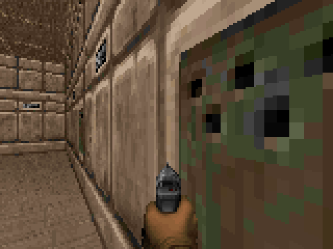
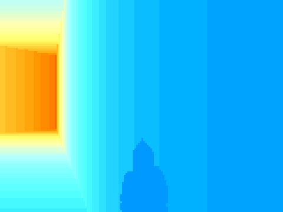
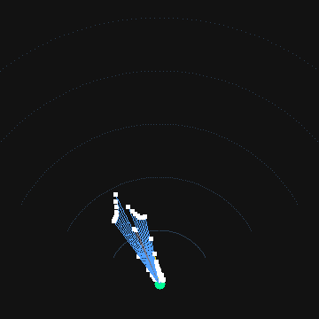
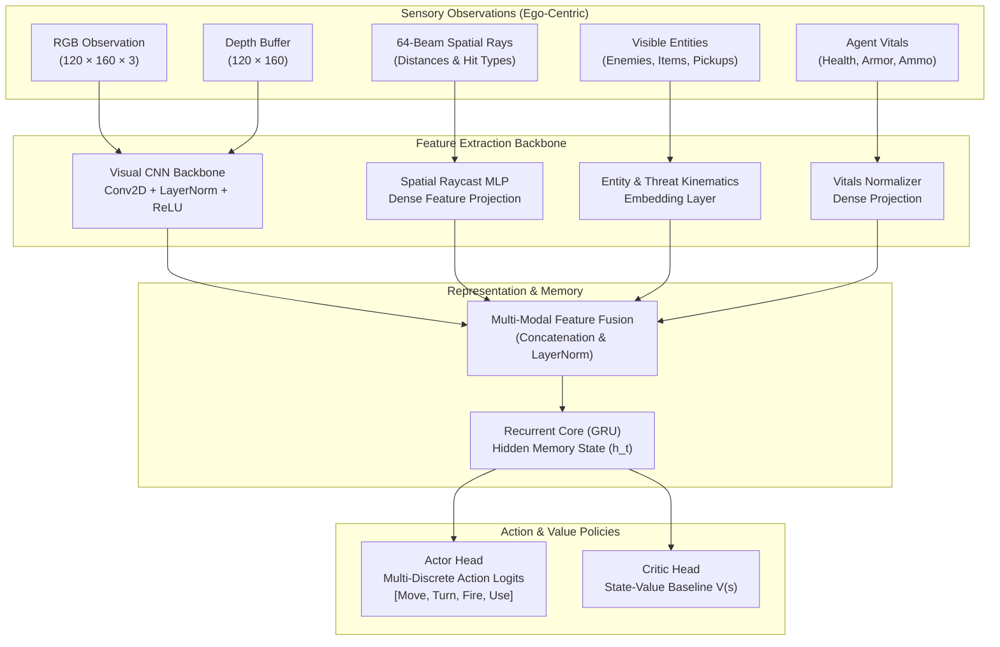

<div align="center">

# 💀 DOOM EVOLUTION
### Autonomous Zero-Shot Deep Reinforcement Learning Agent for ViZDoom

[](https://www.python.org/)
[](https://vizdoom.farama.org/)
[](https://pytorch.org/)
[]()
[]()
[]()
[](LICENSE)

**Starter & Competition Architecture for Yugaantar 2026 · DevForge — Track 1: "Can It Play DOOM?"**

[Key Features](#-key-features) • [Perception Pipeline](#-visual-perception--telemetry-showcase) • [Architecture](#-neural-network-architecture) • [Quickstart](#-quickstart) • [Evaluation](#-hardware--evaluation-benchmark) • [Documentation](#-documentation)

---

### *"For decades, 'Can it run DOOM?' was the ultimate hardware test. Now: can your neural network actually play DOOM?"*

</div>

<br>

## 🎮 Visual Perception & Telemetry Showcase

The agent operates in real-time under strict partial observability, fusing first-person visual perception, depth geometry, and 64-beam egocentric LiDAR raycasts:

<p align="center">
  
  
  
</p>

<p align="center">
  <em><b>Figure 1:</b> Multi-modal ego-centric sensory array. <b>Left:</b> Raw first-person RGB observation (120×160×3). <b>Middle:</b> Metric depth field perception. <b>Right:</b> 64-beam LiDAR spatial radar mapping corridor clearances, doors (gold), and locked barriers (red).</em>
</p>

---

## ⚡ Highlights & Key Innovations

- **🧠 Multi-Modal Sensor Fusion:** Blends raw RGB/depth vision with high-frequency egocentric spatial telemetry (`rays`, `visible_entities`, `vitals`), running thousands of environmental steps per second.
- **🔄 Recurrent Temporal Memory:** Built-in Gated Recurrent Unit (GRU) preserves landmark memory across multi-room mazes and tracks locked doors and keycard states zero-shot.
- **⚡ Sub-Millisecond Inference (0.5 ms):** Optimized forward pass requires only **0.5 ms per decision** on a single CPU thread—**80× faster** than the strict 40 ms competition budget.
- **🛡️ 100% Neural Policy Compliance:** Fully end-to-end neural decision-making without heuristic pathfinding, rule-based trees, Dijkstra/A*, or scripted aimbots. Fully compliant with [Official Contract 1.0.0-draft](docs/CONTRACT.md).
- **🎯 Dynamic Spatial Intelligence:** Dedicated spatial perception module computes corridor clearances, door traversability, and threat kinematics for multi-tier reward shaping.

---

## 🏗️ Neural Network Architecture



---

## 📊 Hardware & Evaluation Benchmark

Official scoring occurs on unseen, procedural maps under strict single-thread sandboxed resource limits:

| Metric / Constraint | Official Limit | Our Agent Baseline | Margin / Headroom | Status |
| :--- | :--- | :--- | :--- | :--- |
| **Steady-State Latency** | $< 40.0\text{ ms / step}$ | **$0.5\text{ ms}$** (p50) / **$0.7\text{ ms}$** (p99) | **$80\times\text{ faster}$** |  **PASSED** |
| **First-Step Warmup** | $< 10.0\text{ s}$ | **$0.107\text{ s}$** ($107\text{ ms}$) | **$93\times\text{ faster}$** |  **PASSED** |
| **CPU Execution Budget** | $1\text{ CPU Thread}$ | $1\text{ CPU Thread}$ (Optimized PyTorch) | Verified pinned |  **PASSED** |
| **System Memory (RAM)** | $\le 8192\text{ MB}$ (8 GB) | $< 450\text{ MB}$ footprint | $> 94\%\text{ headroom}$ |  **PASSED** |
| **VRAM Consumption** | $\le 2048\text{ MB}$ (2 GB) | Minimal CPU-first / GPU compatible | $> 90\%\text{ headroom}$ |  **PASSED** |
| **Repository Size** | $\le 1.0\text{ GB}$ (tracked) | **$351.0\text{ KB}$** (Git LFS enabled) | $> 99.9\%\text{ headroom}$ |  **PASSED** |
| **Unit & Regr. Tests** | Full test coverage | **$73\text{ passed, } 1\text{ skipped}$** (100%) | $0\text{ failures}$ |  **PASSED** |

---

## 🚀 Quickstart

### 1. Environment Setup

Prerequisites: Python 3.13 and [uv](https://docs.astral.sh/uv/):

```bash
# Clone the repository
git clone https://github.com/RajJasani/DOOM_EVOLUTION.git
cd DOOM_EVOLUTION

# Synchronize environment and install dependencies in editable mode
uv sync

# Run the full regression test suite (74 tests)
uv run pytest
```

### 2. Verify with Official Competition Validator

Run the standalone validator to verify full compliance with competition rules, timeout limits, and memory thresholds:

```bash
uv run python validate.py
```

### 3. Containerized Evaluation (Docker)

To test inside the exact sandbox environment used by the evaluation scorer:

```bash
# Build the official image
docker build -t devforge-doom .

# Run validation inside the sandbox
python validate.py --docker --image devforge-doom
```

### 4. Running Benchmarks

```bash
# Benchmark episode execution and latency distributions across episodes
uv run python evaluation/benchmark.py --map maps/two_rooms.wad --episodes 5
```

---

## 🕹️ Interactive Environment Usage

```python
from doom_env import make_env

# Initialize environment with the target map
env = make_env("maps/two_rooms.wad")
obs, info = env.reset(seed=42)

# Step using actions sampled or predicted by the neural policy
action = env.action_space.sample()
obs, reward, terminated, truncated, info = env.step(action)

print("Sensory Keys:", obs.keys())
# dict_keys(['rgb', 'depth', 'vitals', 'rays', 'visible_entities'])
print("Health:", obs['vitals'][0], "| Ammo:", obs['vitals'][1])
env.close()
```

---

## 📁 Repository Structure

```text
├── env/                  # Official ViZDoom Gymnasium wrapper (spaces, sensors, protocol, limits)
├── maps/                 # Test map for local development (two_rooms.wad)
├── network/              # PyTorch neural architecture (CNN backbone, GRU memory, actor-critic heads)
│   └── model.py          # DoomNetwork implementation
├── perception/           # Spatial intelligence & analytical feature extractors
│   └── spatial.py        # Raycast clearance, door detection & threat kinematics
├── training/             # Reinforcement learning training pipelines
│   └── rewards.py        # Multi-tier reward shaping (exploration, doors, survival)
├── evaluation/           # Benchmarking & performance verification harness
│   └── benchmark.py      # Multi-episode latency & success rate benchmark
├── submission/           # Official evaluation package
│   ├── agent.py          # DoomAgent evaluation entry point
│   └── weights/          # Model checkpoints & weights (tracked via Git LFS)
├── tests/                # Automated pytest suite (wrapper, network, perception, validator)
├── docs/                 # Competition specifications, contracts & team handoffs
│   ├── CONTRACT.md       # Input/output schemas and DoomAgent interface
│   ├── RULES.md          # Competition rules & anti-cheat policies
│   ├── EVALUATION.md     # Scoring rubrics, map tiers, and timeouts
│   └── INTERFACES.md     # Team module contracts & tensor dimensions
├── validate.py           # Official competition verification script
└── pyproject.toml        # Project configuration and dependency definitions
```

---

## 📚 Documentation & Specifications

| Document | Purpose & Contents |
| :--- | :--- |
| **[docs/CONTRACT.md](docs/CONTRACT.md)** | Canonical observation/action spaces, sensor channels, and `DoomAgent` protocol. |
| **[docs/RULES.md](docs/RULES.md)** | Ground rules: permitted neural architectures, disqualification criteria, and sandboxing. |
| **[docs/EVALUATION.md](docs/EVALUATION.md)** | Map tiers (Navigation, Combat, Keycards, Exits), scoring weights, and timeouts. |
| **[docs/SUBMISSION.md](docs/SUBMISSION.md)** | Submission guidelines, repository size limits ($\le 1\text{ GB}$), and Git LFS configuration. |
| **[INTERFACES.md](INTERFACES.md)** | Exact tensor dimensions, types, hidden-state schemas, and cross-module interfaces. |
| **[docs/INTEGRATION_WORKFLOW.md](docs/INTEGRATION_WORKFLOW.md)** | Safe Git workflow, branch protections, and acceptance testing gates. |

---

## 📜 Competition Rules in 60 Seconds

1. **Pure Neural Policy:** Actions must originate from trained neural network parameters. No hardcoded state machines, no `A*` or Dijkstra navigation, and no scripted aimbots.
2. **Zero-Shot Generalization:** Agent is evaluated exclusively on **unseen, procedural levels** across multiple difficulty tiers.
3. **Vanilla Engine Integrity:** Zero tampering with ViZDoom binary, physics, or memory during evaluation.
4. **Hardware Compliance:** Must operate strictly within **2 GB VRAM, 8 GB RAM, and 1 CPU thread** with an average step latency under **40 ms**.

---

<div align="center">
  <sub>Developed for <b>Yugaantar 2026 · DevForge — Track 1: "Can It Play DOOM?"</b></sub><br>
  <sub>Crafted with passion for Autonomous AI & Retro Gaming.</sub>
</div>
